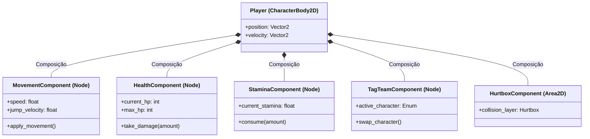

# 🧩 Entidades com Componentes — Ormund Tale

Este documento detalha a arquitetura de **Composição sobre Herança (Entity-Component Pattern)** aplicada em **Ormund Tale** na engine Godot 4.

> **Princípio Central:** Em vez de criarmos árvores de herança profundas e rígidas (ex: `Inimigo -> InimigoQuePula -> InimigoQuePulaEAtira`), cada entidade é um nó raiz básico (`CharacterBody2D` ou `Area2D`) composto por **nós componentes especializados**. Cada componente é independente, reutilizável e comunica-se com a entidade através de sinais e propriedades exportadas.

---

## 1. Matriz de Entidades x Componentes

A tabela abaixo cruza cada entidade do jogo com os componentes que formam seu comportamento:

| Entidade | MovementComponent | HealthComponent | HitboxComponent | HurtboxComponent | StaminaComponent | TagTeamComponent | SpellCasterComponent | GrappleComponent | AIBehaviorComponent | LootDropComponent | PurificationComponent |
| :--- | :---: | :---: | :---: | :---: | :---: | :---: | :---: | :---: | :---: | :---: | :---: |
| **Delphy (Player)** |  Sim |  Sim |  Sim |  Sim |  Sim |  Sim |  Sim | ❌ Não | ❌ Não | ❌ Não | ❌ Não |
| **Bazz (Player)** |  Sim |  Sim |  Sim |  Sim |  Sim |  Sim | ❌ Não |  Sim | ❌ Não | ❌ Não | ❌ Não |
| **Rastreador (Inimigo Nato)** |  Sim |  Sim |  Sim |  Sim | ❌ Não | ❌ Não | ❌ Não | ❌ Não |  Sim (Perseguição) |  Sim (Materiais) | ❌ Não |
| **Morcego (Inimigo Nato)** |  Sim (Voo) |  Sim |  Sim |  Sim | ❌ Não | ❌ Não | ❌ Não | ❌ Não |  Sim (Mergulho) |  Sim (Asas/Dentes) | ❌ Não |
| **Guarda Corrompido** |  Sim |  Sim |  Sim |  Sim |  Sim (Postura) | ❌ Não | ❌ Não | ❌ Não |  Sim (Patrulha/Bloqueio) |  Sim (Cartas/Espadas) | ❌ Não |
| **Sectário Corrompido** |  Sim (Lento) |  Sim |  Sim |  Sim | ❌ Não | ❌ Não |  Sim (Projétil Escuro) | ❌ Não |  Sim (Kiting/Fuga) |  Sim (Cartas/Tomos) | ❌ Não |
| **Ferreiro Corrompido (Boss)** |  Sim (Pesado) |  Sim (Boss) |  Sim |  Sim |  Sim (Postura) | ❌ Não | ❌ Não | ❌ Não |  Sim (Fases de Boss) |  Sim (Martelo Raro) |  Sim (Altar/Ritual) |
| **Madre Virtuosa (Boss)** |  Sim (Flutua) |  Sim (Boss) |  Sim |  Sim |  Sim (Postura) | ❌ Não |  Sim (Espinhos/Luz) | ❌ Não |  Sim (Fases de Boss) |  Sim (Relíquia Sagrada)|  Sim (Altar/Ritual) |
| **Fonte do Deus Hamus** | ❌ Não | ❌ Não | ❌ Não | ❌ Não | ❌ Não | ❌ Não | ❌ Não | ❌ Não | ❌ Não | ❌ Não | ❌ Não | *(Possui `InteractionComponent` e `CheckpointComponent`)* |

---

## 2. Descrição Detalhada dos Componentes

Para fins de apresentação e avaliação técnica, cada componente possui uma responsabilidade única (Single Responsibility Principle):

### 2.1. Componentes Físicos e de Movimento
- **`MovementComponent`:**
  - **Função:** Controla aceleração, fricção, velocidade máxima, aplicação de gravidade, coyote time e buffer de pulo no `CharacterBody2D` pai.
  - **Reutilização:** Usado tanto pelos protagonistas quanto por inimigos que andam pelo solo.

### 2.2. Componentes de Vida e Dano
- **`HealthComponent`:**
  - **Função:** Gerencia os pontos de vida (HP) atuais e máximos. Emite sinais como `health_changed(current, max)` e `died`.
  - **Vantagem:** Não precisa saber quem causou o dano; apenas calcula redução e dispara eventos.
- **`HurtboxComponent` (`Area2D`):**
  - **Função:** Área de colisão que recebe ataques. Ao detectar um `HitboxComponent`, consulta a força do golpe e repassa o dano para o `HealthComponent` irmão.
- **`HitboxComponent` (`Area2D`):**
  - **Função:** Área de colisão que causa dano ativo (adagas, magias, corpo de monstros). Carrega propriedades de dano, tipo de dano (físico/mágico) e knockback.

### 2.3. Componentes de Combate e Habilidades
- **`StaminaComponent`:**
  - **Função:** Controla a barra de estamina/vigor necessária para esquivas, bloqueios e parries.
- **`TagTeamComponent`:**
  - **Função:** Exclusivo dos protagonistas. Gerencia a alternância instantânea entre Delphy e Bazz, mantendo a inércia, posição e estado compartilhado da dupla.
- **`SpellCasterComponent`:**
  - **Função:** Instancia e projeta feitiços (projéteis elementais, áreas de efeito e canto hipnotizante). Utilizado por Delphy e adaptado para chefes conjuradores.
- **`GrappleComponent`:**
  - **Função:** Dispara gancho retrátil, calcula trajetórias em direção a pontos de ancoragem e puxa o herói Bazz.

### 2.4. Componentes de Inteligência e Progressão
- **`AIBehaviorComponent`:**
  - **Função:** Máquina de estados desacoplada que controla tomadas de decisão de inimigos e chefes (Patrulhar, Perseguir, Atacar, Recuar).
- **`LootDropComponent`:**
  - **Função:** Instancia itens, moedas, cartas de bestiário e armamentos ao receber o sinal `died` do `HealthComponent`.
- **`PurificationComponent`:**
  - **Função:** Monitora janelas de oportunidade em chefes corrompidos (ex: quando atordoados ou com postura quebrada). Permite que o jogador execute a purificação mística em vez de matá-los.

---

## 3. Diagrama Visual de Composição (Árvore de Nós)

